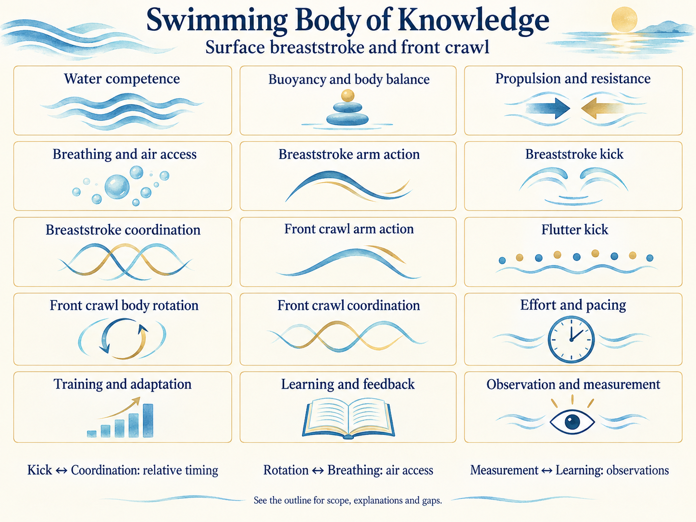

# Swim KPS

## Key takeaway
Explore evidence-aware, self-contained breaststroke and freestyle self-coaching knowledge, while keeping safety, observation, uncertainty and personal experience distinct.

## Summary
Swim KPS is a public, open-source self-coaching knowledge package for swimmers and contributors—not a swimming-instructor curriculum, individualized assessment, medical recommendation or substitute for in-person supervision. The two stroke Practices include reference movements, the reasons for trying them, executable procedures, troubleshooting and blank current-technique summaries. No ability, distance achievement, pain diagnosis or completed session has been inferred.

Explore the [Body of Knowledge Outline](docs/body-of-knowledge-outline.md) for central questions, required understanding, subsystem interfaces and gaps. The illustration shows selected connections, not a lesson sequence or precise stroke demonstration.

## Start safely
Begin with [Start here](guides/START-HERE.md) and the inline safety boundary of the selected Practice: [Self coach breaststroke](practices/self-coach-breaststroke.md) or [Self coach freestyle](practices/self-coach-freestyle.md). Breaststroke has eight stages and freestyle seven; each supplies a summary, understanding, procedure, observations and next/fallback.

Self-coaching means choosing your learning question, not swimming alone. Use a suitable lifeguarded pool with a companion and appropriate close assistance when inexperienced. If you cannot reliably get air, stop and regain support in the chosen task, obtain in-person instruction before unsupported experiments. Stop for pain, distress or repeated water inhalation. No forced breath restriction, hyperventilation, racing pullouts, diving, open-water work or rehabilitation is prescribed. [Red Cross safety](references/american-red-cross-undated-swimming-safety.md) and [Dangerous breath holding](references/boyd-2015-dangerous-underwater-breath-holding.md) support these boundaries, not personal clearance.

## Explore by subject

The [Swimming Body of Knowledge Outline](docs/body-of-knowledge-outline.md) lists direct topics with scope, components, relationships and interfaces. All fifteen areas now link to self-contained Models with definitions, mechanisms, interfaces and worked examples. Coverage tables retain the 34 detailed topics and distinguish introductory explanations from deeper gaps. Start with the [breaststroke kick worked comparison](models/breaststroke-kick-model.md#worked-comparison) to see how kick, forces, balance and timing connect. Use the Practices for activities and their prerequisites.

## Structure and reading profile
The five core folders are `concepts/`, `principles/`, `models/`, `methods/` and `practices/`. `references/` holds Markdown records identifying external publications and their actual contributions. No original source binaries, platform-specific editions or sibling-package files are required.

Read the Markdown directly; no scripts are needed for using the library. `guides/` contains starting routes, the pool card and blank session template. `docs/` contains the knowledge outline, file index, source synthesis and maintenance guide. Contributor instructions live in `.github/CONTRIBUTING.md`. Each Practice keeps its instructions inline; numbered stages are a recommended route subject to their prerequisites.

## Package and language versions
Package version: **4.0.1**. Language compatibility: **KPS 9.x**. Exact authoring contract checked for this release: **9.0.0**. Compatibility is a promise about unchanged required meanings within that major line, not a claim that future tools or releases have been tested. Exact declarations are in [publication.json](publication.json); the checker pin is in [upstream-lock.json](upstream-lock.json). Package versions identify Swim content; KPS versions identify the authoring contract. Neither is a runtime dependency on a sibling checkout.

## Maintenance and validation
Run `python3 validate.py .` for structure and links, then `python3 -m unittest discover -s tests -v` before submitting a change. [Maintenance](docs/MAINTENANCE.md) explains the retained checks, dependency review and optional archive checks. Python's standard library is sufficient; no KPS install is needed.

The [authoritative KPS Core contract](https://github.com/xiongxianfei/knowledge-practice-system/blob/8fd410d1a8dec8b3e38352c9166639906049ec55/AUTHORING.md) defines shared authoring requirements, while [Contributing](.github/CONTRIBUTING.md) contains Swim-specific authoring, navigation, evidence review, privacy and PR guidance.

## Evidence and limits
Read the [Reference inspection notes](references/README.md#inspection-scope-and-history) and the local evidence summaries before extrapolating a claim. Reference count is not independent evidence count. The package is authored synthesis; working links, metadata and checksums do not establish scientific truth, competence, suitability or effectiveness. Only Markdown reference records are bundled.

## Find knowledge
[Knowledge index](docs/INDEX.md) and [Method to reason map](guides/WHY-MAP.md) connect tasks to their rationale. The [pool card](guides/POOL-CARD.md) provides a compact reminder after reading the relevant Practice.

## Public participation and personal observations
This repository publishes reusable explanations, bounded Methods, self-contained Practices and structured Reference records. It does **not** publish the author's personal swimming journal. Actual session records should be stored separately and privately; the [blank session template](guides/SESSION-TEMPLATE.md) is available for private reuse. Do not upload personal health records, another swimmer's footage or identifying details in Issues or PRs.

Submit a [knowledge correction or proposal](.github/CONTRIBUTING.md) with the specific claim, observed limitation, source access extent and proposed revision. A reported result is an individual observation, not a universal instruction.

## License and publication
Project-authored text and code are offered under the [MIT license](LICENSE), subject to review of publication rights; external Reference records identify third-party publications without re-licensing those publications. This release is based on Swim 4.0.0 knowledge, not a new validation of the swimming claims. [Contribution and release workflow](.github/CONTRIBUTING.md).
