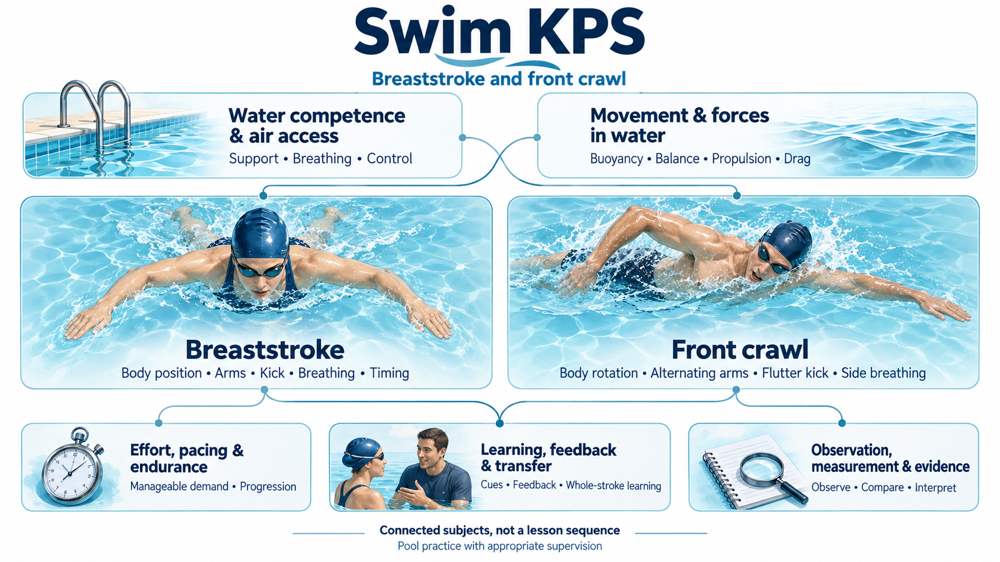

# Swimming subject map

## Key takeaway

Explore breaststroke and front crawl by subject, with the relevant explanations beside each topic. Connect stroke technique to air access, body support, forces, learning and observation.

## Summary

This map covers the package's supervised pool self-coaching scope. It reuses established distinctions in stroke coaching and physical explanation, with an authored selection of learning and observation topics. The outline describes the subject; the linked Practices supply activities, prerequisites and their recommended order.

The illustration previews the subjects below. Lines show selected associations; the swimmer images identify the strokes rather than demonstrate exact technique. This is an AI-generated illustration made with the built-in image generation tool; its [generation prompt](../diagrams/subject-map.prompt.txt) is retained beside the PNG. The outline below remains the maintained text account.

## Scope

The focus is surface breaststroke and front crawl, called freestyle in the existing Practice. Supporting topics concern dependable air access, movement in water and bounded self-coaching. This is a selected subject outline rather than a complete swimming curriculum. Backstroke, butterfly, racing starts and turns, underwater pullouts, open-water swimming, rescue and rehabilitation are outside the current package.

The [Safety boundary](../SAFETY.md) governs every linked in-water task: suitable supervision and dependable breathing, stopping and support; no breath restriction or forced painful movement. The map is navigation, not permission to attempt an unfamiliar task. First-time water competence requires appropriate in-person instruction. Start with [Start here](../guides/START-HERE.md) and the relevant Practice before using a Method.

## Subject outline

1. [Water competence and air access](#water-competence-and-air-access) — support, breathing and control in the chosen environment.
2. [Movement and forces in water](#movement-and-forces-in-water) — buoyancy, balance, alignment, propulsion and resistance.
3. [Breaststroke](#breaststroke) — body position, arms, kick, breathing and whole-stroke timing.
4. [Front crawl](#front-crawl) — body position and rotation, alternating arms, flutter kick and side breathing.
5. [Effort pacing and endurance](#effort-pacing-and-endurance) — task demand, continuity and controlled progression.
6. [Learning feedback and transfer](#learning-feedback-and-transfer) — cues, component work, feedback and whole-stroke learning.
7. [Observation measurement and evidence](#observation-measurement-and-evidence) — visible events, comparable measurements and interpretation.

Existing explanations are aligned with their topics below. A Method link supplies a procedure as well as its local rationale; a Practice link supplies contextual application. Coverage limits remain in the row. **Source only** identifies an external Reference contribution rather than a completed local lesson. A shared explanation may appear under several topics.

## Water competence and air access

This area concerns control and access to air before technique comparisons. Stroke breathing also connects to coordination and effort.

| Topic | What it covers and connects to | Existing explanations |
|---|---|---|
| Readiness environment and assistance | Whether the chosen task has dependable support and suitable help; connects all in-water activity to its prerequisites | [Check readiness](../methods/check-readiness.md); [Safety boundary](../SAFETY.md) |
| Stopping and regaining support | The capability needed to end an activity and regain air; connects water competence to supported practice | [Safety boundary](../SAFETY.md) explains the entry requirement. A complete beginner lesson in entries, exits and recovery is not provided; obtain in-person instruction. |
| Breathing cycle and air access | Air movement and the opportunity to inhale; connects mouth clearance, timing and task demand | [Breathing cycle](../concepts/breathing-cycle.md); [Breathing and air access Model](../models/breathing-and-air-access-model.md); [supported breathing Method](../methods/explore-supported-breathing.md) |
| Breathing within the stroke | The relationship between air access and ongoing arm, leg and body movement | [Air access and stroking share timing](../principles/air-access-and-stroking-share-timing.md); [breaststroke cycle](../models/breaststroke-cycle-model.md); [side breathing](../methods/integrate-side-breathing.md) |
| Discomfort and interpretation limits | The boundary between observing difficulty and inferring a diagnosis or stroke fault | [Pain location does not identify a stroke fault](../principles/pain-location-does-not-identify-a-stroke-fault.md); [Safety boundary](../SAFETY.md). No diagnostic or rehabilitation lesson. |

## Movement and forces in water

These physical descriptions support both strokes. A representation of forces explains relationships under assumptions; it does not determine an individual swimmer's best technique.

| Topic | What it covers and connects to | Existing explanations |
|---|---|---|
| Buoyancy support and balance | Upward support and body orientation are different questions; connects floating to posture and movement | [Buoyancy](../concepts/buoyancy.md); [buoyancy versus orientation](../principles/buoyancy-and-orientation-are-distinct.md); [Body support and balance Model](../models/body-support-and-balance-model.md) |
| Body alignment | Relative positions of head, trunk and limbs through the task; connects posture to breathing and resistance | [Body alignment](../concepts/body-alignment.md); [Check body line](../methods/check-body-line.md) |
| Propulsion and force direction | Water interaction contributing to movement; connects limb action with translation and rotation | [Propulsion](../concepts/propulsion.md); [force direction and application](../principles/force-direction-and-application-affect-motion.md); [Force and resistance Model](../models/force-and-resistance-model.md) |
| Drag and body configuration | Resistance in relation to water-relative speed, shape and flow; connects alignment and recovery to movement | [Drag](../concepts/drag.md); [resistance varies with speed and configuration](../principles/resistance-varies-with-speed-and-configuration.md); [Force and resistance Model](../models/force-and-resistance-model.md). No individual drag measurement follows from a visual observation. |
| Limb orientation and recovery | How a limb is positioned for an action and returned for the next one; connects preparation, water interaction and timing | [Limb orientation](../concepts/limb-orientation.md); [configuration and effort](../principles/limb-configuration-changes-the-effect-of-effort.md); [recovery and resistance](../principles/recovery-repositions-limbs-and-alters-resistance.md) |

## Breaststroke

The subject divisions follow the coaching topics of body position, arm action, kick, breathing and timing. Their relationships matter within a complete cycle; the divisions are not instructions to insert pauses.

| Topic | What it covers and connects to | Existing explanations |
|---|---|---|
| Body position and return to length | Body configuration across the cycle; connects breathing and limb recovery to the next action | [Body alignment](../concepts/body-alignment.md); [Breaststroke cycle Model](../models/breaststroke-cycle-model.md); [Check body line](../methods/check-body-line.md) |
| Arm action and recovery | Preparation, inward action and forward return; connects arm movement to air access | [Breaststroke cycle Model](../models/breaststroke-cycle-model.md); [Explore breaststroke arms](../methods/explore-breaststroke-arms.md) |
| Kick preparation action and completion | Foot and leg configuration through the kick; connects limb orientation with movement and comfort | [Breaststroke kick Model](../models/breaststroke-kick-model.md); [Check breaststroke kick](../methods/check-breaststroke-kick.md) |
| Breathing within the cycle | The breathing opportunity in relation to body and arm movement | [Breathing and air access Model](../models/breathing-and-air-access-model.md); [Explore breaststroke arms and breathing](../methods/explore-breaststroke-arms.md) |
| Coordination and continuity | Relative timing of arms, legs, breathing and return to length; connects component actions to the whole stroke | [Coordination](../concepts/coordination.md); [relative timing](../principles/relative-timing-changes-the-whole-stroke.md); [Coordinate breaststroke](../methods/coordinate-breaststroke.md); [Compare continuity](../methods/compare-breaststroke-continuity.md) |

The [Breaststroke Practice](../practices/self-coach-breaststroke.md) supplies the complete self-coaching route and its stop conditions. The outline does not prescribe one glide duration, joint geometry or racing technique.

## Front crawl

Body position, alternating arm action, kick and breathing provide the main coaching divisions. Rotation and timing connect them within the cycle.

| Topic | What it covers and connects to | Existing explanations |
|---|---|---|
| Body position and rotation | Body orientation through the cycle; connects arm action with breathing | [Body alignment](../concepts/body-alignment.md); [Front crawl cycle Model](../models/front-crawl-cycle-model.md); [Check body line](../methods/check-body-line.md) |
| Arm entry underwater action and recovery | The alternating arm cycle; connects preparation and water interaction to the opposite arm's action | [Front crawl cycle Model](../models/front-crawl-cycle-model.md); [Explore front crawl arms](../methods/explore-front-crawl-arms.md). Source differences about entry and path remain in the linked account. |
| Flutter kick | Leg action alongside arms and breathing; connects local movement to whole-task demand | [Explore flutter kick](../methods/explore-flutter-kick.md); [Front crawl cycle Model](../models/front-crawl-cycle-model.md) |
| Side breathing | Access to air in relation to body turn and arm timing | [Integrate side breathing](../methods/integrate-side-breathing.md); [air access and stroking timing](../principles/air-access-and-stroking-share-timing.md) |
| Whole stroke coordination | Whether the component actions coexist within the intended task | [Coordination](../concepts/coordination.md); [Integrate front crawl](../methods/integrate-front-crawl.md); [relative timing](../principles/relative-timing-changes-the-whole-stroke.md) |

The [Freestyle front crawl Practice](../practices/self-coach-freestyle.md) supplies the activity route. The map does not select one breathing count, kick count or hand path for every swimmer.

## Effort pacing and endurance

This area relates task demand to breathing, coordination and continued control. Current coverage concerns manageable self-coaching tasks rather than a full conditioning program.

| Topic | What it covers and connects to | Existing explanations |
|---|---|---|
| Perceived effort and breathing demand | How difficult the task feels alongside breathing and execution; connects subjective experience to pacing questions | [Perceived effort](../concepts/perceived-effort.md); [Breathing and air access Model](../models/breathing-and-air-access-model.md). These do not measure metabolic cost. |
| Pace and stroke continuity | How the task and timing relate to observed movement; connects coordination to time and count | [Compare breaststroke continuity](../methods/compare-breaststroke-continuity.md); [Stroke measurement Model](../models/stroke-measurement-model.md). General pacing strategy remains incomplete. |
| Controlled progression and recovery between attempts | Changes in task demand and rest conditions; connects repeated activity to continued control | [Progress controlled distance](../methods/progress-controlled-distance.md) provides bounded progression. A full account of training load and recovery is not yet provided. |
| Endurance and physiological adaptation | How sustained capacity develops across training; connects workload and recovery over time | No dedicated explanation or training program yet; further sources and qualified domain development needed. |

## Learning feedback and transfer

Self-coaching relates an observation and a candidate change to subsequent performance. A helpful cue and a supported mechanism answer different questions.

| Topic | What it covers and connects to | Existing explanations |
|---|---|---|
| Cues and attention | A brief instruction or image used to guide an action; connects an intended adjustment to what the swimmer attempts | [Cue](../concepts/cue.md); [Self coaching Model](../models/self-coaching-model.md) |
| Component practice and transfer | Whether an effect survives the change from a simplified task to whole swimming | [Transfer](../concepts/transfer.md); [isolated success and transfer](../principles/isolated-success-does-not-establish-transfer.md); [Check whole stroke transfer](../methods/check-whole-stroke-transfer.md) |
| Feedback and adjustment | External observations and bounded comparisons used to refine a question or action | [Request targeted feedback](../methods/request-targeted-feedback.md); [Compare one safe adjustment](../methods/compare-one-safe-adjustment.md) |
| Retaining and revising working technique | How a local observation informs a provisional personal choice | [Record and update technique](../methods/record-and-update-technique.md); [Self coaching Model](../models/self-coaching-model.md); [Use Swim KPS](../practices/use-swim-kps.md) |
| Skill acquisition and long term retention | How learning persists and becomes usable across occasions | No comprehensive motor-learning account yet. Existing self-coaching guidance is authored application, not proof of long-term learning effects. |

## Observation measurement and evidence

This area distinguishes an event, a measurement and an explanation. It supports learning decisions while preserving what a comparison can and cannot establish.

| Topic | What it covers and connects to | Existing explanations |
|---|---|---|
| Observation and causal hypothesis | Separating what was noticed from why it might have happened | [Observation and hypothesis](../concepts/observation-and-hypothesis.md); [multiple possible causes](../principles/observation-does-not-identify-one-cause.md); [Observe one stroke question](../methods/observe-one-stroke-question.md) |
| Cycle definition and stroke metrics | What counts as an event and which quantities are compared | [Stroke cycle](../concepts/stroke-cycle.md); [Stroke metrics](../concepts/stroke-metrics.md); [Stroke measurement Model](../models/stroke-measurement-model.md) |
| Comparable swims and interpretation | Conditions that affect a comparison; connects time, count and effort without reducing quality to one number | [Measure comparable swims](../methods/measure-comparable-swims.md); [stroke count and energy cost](../principles/fewer-strokes-do-not-identify-lower-energy-cost.md) |
| Video and outside observation | What a permitted view can show and what remains hidden; connects feedback with measurement limits | [Record permitted video](../methods/record-permitted-video.md); [Request targeted feedback](../methods/request-targeted-feedback.md) |
| Source comparison and applicability | Which evidence addresses a question, and how its conditions differ from the intended use | [Synthesize swimming sources](../methods/synthesize-swimming-sources.md); [Source synthesis example](SOURCE-SYNTHESIS.md). This is not a complete research-methods curriculum. |

## Connections across subjects

| Connection | Relationship to follow | Existing explanations |
|---|---|---|
| Support and alignment | Enough buoyant support does not by itself determine orientation | [Body support and balance Model](../models/body-support-and-balance-model.md) |
| Breathing and coordination | A component action changes the timing available for air access | [Breathing Model](../models/breathing-and-air-access-model.md); [breaststroke](../models/breaststroke-cycle-model.md) and [front crawl](../models/front-crawl-cycle-model.md) cycle Models |
| Limb action and resistance | Preparation and recovery affect the configuration accompanying propulsion | [Limb configuration](../principles/limb-configuration-changes-the-effect-of-effort.md); [recovery and resistance](../principles/recovery-repositions-limbs-and-alters-resistance.md) |
| Component work and whole swimming | Support or isolation changes the task, so transfer is a separate question | [Transfer Principle](../principles/isolated-success-does-not-establish-transfer.md); [Check whole stroke transfer](../methods/check-whole-stroke-transfer.md) |
| Effort and measurement | A lower count, faster time and easier-feeling swim describe different outcomes | [Stroke measurement Model](../models/stroke-measurement-model.md) |
| Observation and learning decisions | A visible change can inform the next question without proving one cause | [Self coaching Model](../models/self-coaching-model.md) |

## Adopted accounts and limits

| Account | Contribution to the outline | Boundary |
|---|---|---|
| Swim England [breaststroke](../references/swim-england-2018-improving-breaststroke-technique.md) and [front crawl](../references/swim-england-2018-improving-front-crawl-technique.md) | Stroke divisions for body position, arm action, kicking, breathing and timing relationships | Selected surface-stroke topics; advanced turns and racing advice are outside this map |
| US Masters Swimming [breaststroke kick](../references/us-masters-swimming-undated-breaststroke-kick.md), [pull](../references/us-masters-swimming-undated-breaststroke-pull.md), [freestyle pull](../references/us-masters-swimming-undated-freestyle-pull.md), [kick](../references/us-masters-swimming-undated-freestyle-kick.md) and [breathing](../references/us-masters-swimming-undated-freestyle-breathing.md) | Additional component coaching accounts | Guidance can differ between sources; no universal optimum is inferred |
| [University Physics](../references/moebs-2016-university-physics-volume-1.md) and [NASA drag equation](../references/nasa-undated-drag-equation.md) | Force, buoyancy, rotational effects and resistance | Physical relationships need their assumptions; they do not prescribe technique |
| [Red Cross](../references/american-red-cross-undated-swimming-safety.md), [RNLI](../references/rnli-undated-float-to-live.md) and [breath-holding investigation](../references/boyd-2015-dangerous-underwater-breath-holding.md) | Existing water-safety boundaries and limits | RNLI floating guidance is not a prone-stroke lesson; these records do not establish individual readiness |
| [Passive drag study](../references/cortesi-2015-head-position-and-passive-drag.md) and [breaststroke kinematics study](../references/gourgoulis-2022-breaststroke-arm-kinematics.md) | Bounded examples for configuration and task-dependent measurements | Selected study populations and conditions; no automatic transfer to an individual swimmer |

The two Swim England pages were revisited on 2026-10-14 for their subject divisions in HTML; linked videos were not inspected. Other records retain their earlier inspection extents. The seven-area grouping is our selected navigation structure. Learning, training and observation topics include explicit gaps where the package lacks fuller accounts. Adding a link does not extend the evidence of its destination.

## Using the map

Keep the subject outline here and the complete file inventory in the [knowledge index](INDEX.md). The [Method to reason map](../guides/WHY-MAP.md) explains procedure dependencies. Practices select activities and retain their inline rationale and safety conditions; this subject map does not replace them.

Concepts, Principles, Models, Methods and Practices remain the five document roles. Several roles can explain one topic, and one explanation can serve several topics. Missing explanations remain visible as gaps rather than empty files or invented results.
