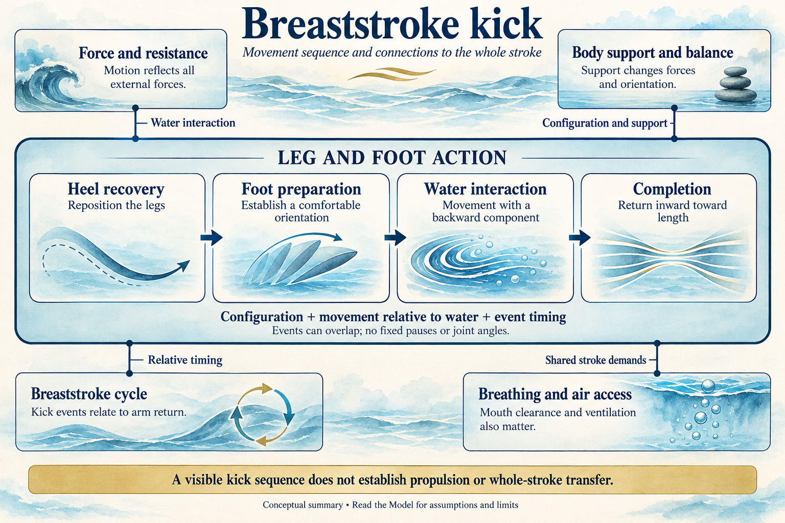
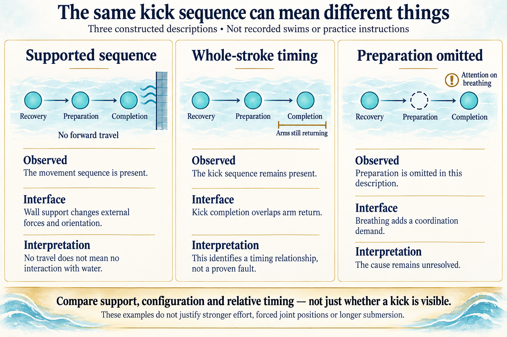

# Breaststroke kick interaction model

## Key takeaway

Distinguish preparation, useful interaction and completion without requiring one joint geometry.

## Summary

Separate preparation, interaction with water and return toward length. The kick connects to net forces, body balance, air access and whole-stroke timing. A recognisable supported sequence does not establish free-swimming propulsion or transfer. The worked comparison shows which additional relationships matter while keeping the cause of an observed difficulty unresolved.

## Overall illustration

The central panel represents the kick subsystem; the four surrounding panels explain its interfaces. Symbols are conceptual, not leg positions or force measurements. The sequence names events without prescribing fixed pauses or joint angles. [Generation prompt](../diagrams/breaststroke-kick-overview.prompt.txt).

## Local explanatory basis

Changing limb orientation and motion can change the direction and useful contribution of the interaction with water. Performance under a simplified drill’s conditions does not by itself establish performance under whole-stroke conditions. A pain report at a joint does not uniquely identify the movement error or tissue condition responsible.

## Purpose
Distinguish preparation, useful interaction and completion without requiring one joint geometry.

## System boundary and components

The question is: **How do leg-and-foot configuration and event order form a kick, and what changes when it becomes part of a whole stroke?** The represented unit is the surface breaststroke leg action in its surrounding task. It includes hip, knee, ankle and foot configuration insofar as these describe recovery, preparation and completion. It does not model muscle activation, tissue loading or an entire swimmer's physiology.

| Component or variable | Role in the representation |
|---|---|
| Heel and leg recovery | Repositions the legs for the next action |
| Foot and leg configuration | Describes orientation before and during interaction with water |
| Movement relative to water | Connects configuration to a changing fluid interaction; shape alone is insufficient |
| Preparation and completion events | Define what can be located within the kick cycle |
| Surrounding body and support conditions | Establish the context in which the same visible leg sequence occurs |
| Timing relative to arms and breath | Connects the local kick events to the whole stroke |

These are explanatory variables, not a list of ideal angles or measured forces. The phase sequence below describes events; it does not assign compulsory pauses or durations.

## Essential terms

**Recovery** repositions the legs for the next kick. **Preparation** establishes a usable foot/leg orientation before the main action. **Configuration** means the connected positions and orientations of the limb segments. **Water-relative movement** is movement with respect to the surrounding water, not merely relative to the torso. **Completion** names the return toward length; it is not a compulsory hold. **Transfer** means the ability to use a component within a changed task, such as a whole stroke.

## Representation
`Heel recovery → comfortable foot preparation → backward-oriented interaction → inward completion and length`

| Observable | What it can suggest | What it cannot establish |
|---|---|---|
| Feet prepare before effort | A relevant event is present | Magnitude of propulsion or a safe joint load |
| Hands held at a wall | Sequence can be examined with support | Forward propulsion measured by travel |
| Greater travel in a free attempt | A task-level change occurred | Its cause without considering push-off, effort and timing |
| A painful position | The task should stop | A particular ligament/muscle diagnosis |

Swim England describes rounded outward/backward movement; USMS emphasizes backward travel and individual variation. The library does not declare these descriptions equivalent or prove one optimal. Its chosen reference keeps preparation, a backward component and completion while allowing a comfortable path. Hip, knee and ankle movement jointly influence the available configuration; do not force a foot shape independently of the rest of the leg.

## Interfaces with other systems

| Connected Model | Relationship across the boundary | Consequence for interpretation |
|---|---|---|
| [Force and resistance](force-and-resistance-model.md) | Leg motion changes interaction with water; whole-body acceleration depends on the sum of external forces | Forward movement cannot be assigned to the kick alone, and a wall can supply an additional external force |
| [Body support and balance](body-support-and-balance-model.md) | Limb configuration, surrounding body orientation and support conditions enter the balance account | A secure hold changes the force and moment balance; a supported posture does not predict the same orientation in free swimming |
| [Breaststroke cycle](breaststroke-cycle-model.md) | Kick preparation and completion have timing relationships with arm return and the next arm action | Identifying a kick event is different from showing that its relationship to the arms fits the whole task |
| [Breathing and air access](breathing-and-air-access-model.md) | The cycle must accommodate ventilation and actual mouth clearance alongside leg action | A kick description alone does not establish an inhalation opportunity or explain every breathing difficulty |

For the whole swimmer, the force account is `sum of external forward forces = mass × forward acceleration` under its stated approximation. Internal muscular effort is not an additional external propulsive force. At a wall, support reactions are part of the external-force balance. In free swimming, the boundary conditions differ. The balance account also needs force locations and their moments; knowing total upward support alone does not establish body orientation. These physical relationships constrain an explanation without selecting a unique kick path.

## Worked comparison

**Constructed teaching example:** the following descriptions are hypothetical, not recordings or observations of a learner. They explain what a comparison could mean; they are not instructions to reproduce these situations.

The strips highlight selected events, not every phase or a measured timeline. The dashed preparation marker describes an omission in one hypothetical case; it does not identify its cause. [Generation prompt](../diagrams/breaststroke-kick-comparison.prompt.txt).

| Description | What the kick Model establishes | What its interfaces add |
|---|---|---|
| A secure supported rehearsal shows heel recovery, foot preparation and completion, with no forward travel | The described movement sequence is present | The support changes external forces and orientation. Lack of travel does not establish lack of a leg-water interaction |
| A whole-stroke description retains those kick events, but completion occurs while the arms are still returning | The local event sequence is still present | The cycle Model adds the arm-kick relationship; the force and balance Models add changing configuration and support. No timing fault or drag magnitude follows from this description alone |
| In another whole-stroke description, preparation is omitted as the swimmer attends to taking a breath | The local sequence has changed as task demands changed | The breathing and cycle Models help frame a coordination question; the description does not establish whether attention, timing, effort or another factor caused the omission |

The meaningful comparison is therefore not simply **kick present versus kick absent**. It also asks whether support, configuration and relative timing changed, and whether the observation can distinguish competing explanations. If preparation remains present but the outcome differs, preparation alone cannot explain that difference. If the conditions or viewpoint are not comparable, even that interpretation must remain tentative.

For example, a claim that a visible kick *must* produce the same forward movement at a wall and in a whole stroke fails because the external conditions differ. A claim that restoring preparation *must* solve breathing fails because mouth clearance and ventilation are additional relationships. Neither conclusion justifies a stronger kick, forced joint position or longer submersion.

The existing [kick Method](../methods/check-breaststroke-kick.md) and [breaststroke Practice](../practices/self-coach-breaststroke.md#stage3-kick-preparation-and-completion) own action, prerequisites, observation and fallback. This explanation adds no new procedure, result or individual diagnosis.

## Assumptions
Comfortable, unforced range and surface-stroke conditions. Do not manipulate the knees or feet to imitate a diagram.

## Implications
Slow rehearsal can make preparation easier to notice, but a temporary pause is not a universal timing rule. A successful isolated kick still needs reintegration with breathing and arms.

## Evidence and evaluation
[Improving your kicking in breaststroke](../references/swim-england-2018-improving-breaststroke-kick.md#foot-preparation-and-kick-completion) and [Breaststroke Kick: The Complete Guide](../references/us-masters-swimming-undated-breaststroke-kick.md#preparation-kick-direction-and-individual-width) provide coaching guidance. [University Physics Volume 1](../references/moebs-2016-university-physics-volume-1.md#net-force-and-translational-motion) supplies only general mechanics; it does not prove a particular foot angle or a muscular diagnosis.

## Inspection for this revision

On 2026-10-14, the Swim England kick page's numbered tips were rechecked for preparation and completion, and the USMS kick guide's goal, direction, recovery and width sections were rechecked for their movement descriptions and differences. These are selected HTML text passages; no linked videos, drills or training sets were evaluated. The Reference records retain their earlier source summaries and access dates.

OpenStax sections 5.3, 10.6 and 14.4 were rechecked in HTML for the system boundary and net-force relation, force moment arms, and displaced-fluid buoyancy. The book supplies general physical constraints, not an experiment on these hypothetical swims. Existing connected Models supply the scoped whole-stroke and air-access accounts. The interface table and worked comparison are authored applications; they have not received separate human domain review.

## Limits
No prescribed knee spacing, explosive-force target, vertical-kick drill or painful comparison. Pain requires stopping the aggravating task and suitable assessment.

## Local evidence summary

[Improving your kicking in breaststroke](../references/swim-england-2018-improving-breaststroke-kick.md#foot-preparation-and-kick-completion) contributes: The guidance emphasizes preparing the feet and completing the kick, with controlled practice of the leg action.

[Breaststroke Kick: The Complete Guide](../references/us-masters-swimming-undated-breaststroke-kick.md#preparation-kick-direction-and-individual-width) contributes: The guide distinguishes foot preparation from the propulsive action and discusses individual variation in workable kick width.

[University Physics Volume 1](../references/moebs-2016-university-physics-volume-1.md#net-force-and-translational-motion) contributes: In the constant-mass classical approximation, net external force determines centre-of-mass acceleration.

Citation identifies support for the stated claim and scope. Any further causal or practical inference remains separately reviewable.

## Deeper knowledge

Canonical dependencies and Reference records provide additional derivation, source inspection and alternatives. They are not required to carry out the local explanation or procedure.

- **Concepts:** [Limb orientation](../concepts/limb-orientation.md)
- **Concepts:** [Coordination](../concepts/coordination.md)
- **Principles:** [Limb configuration changes the effect of effort](../principles/limb-configuration-changes-the-effect-of-effort.md)
- **Principles:** [Isolated success does not establish transfer](../principles/isolated-success-does-not-establish-transfer.md)
- **Principles:** [Pain location does not identify a stroke fault](../principles/pain-location-does-not-identify-a-stroke-fault.md)
- **References:** [Improving your kicking in breaststroke](../references/swim-england-2018-improving-breaststroke-kick.md)
- **References:** [Breaststroke Kick: The Complete Guide](../references/us-masters-swimming-undated-breaststroke-kick.md)
- **References:** [University Physics Volume 1](../references/moebs-2016-university-physics-volume-1.md)
- **References:** [Knee pain](../references/nhs-undated-knee-pain.md)
